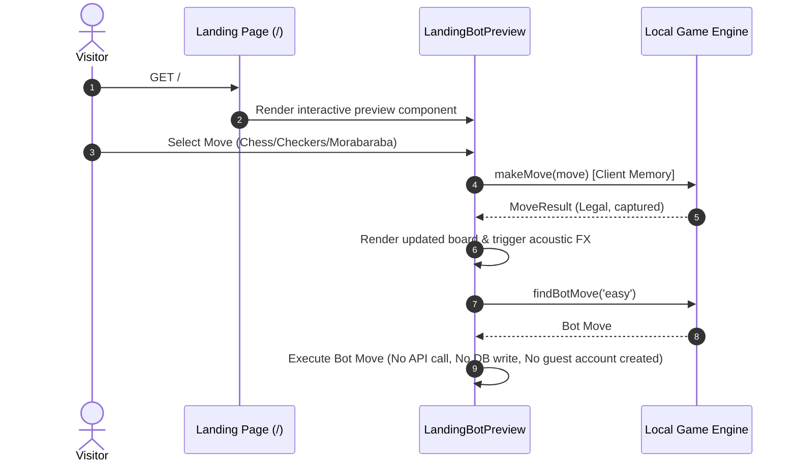

# BIBO System Architecture & State Authority Specification

## 1. System Overview

BIBO is a real-time, browser-based abstract strategy game platform unifying three disciplines:
1. **Chess** (Standard 8×8 FIDE rules, Stockfish 16 WASM AI integration)
2. **Checkers** (American 8×8 Draughts with mandatory captures, multi-jump chains, and king promotion)
3. **Morabaraba** (Traditional 24-point South African mill game with placing, moving, and flying phases)

The platform is designed with an OLED-dark tactile visual aesthetic, real-time Server-Sent Events (SSE) multiplayer room synchronization, client-side Web Audio API acoustic synthesis, mobile haptic feedback, and an offline-first match archive.

---

## 2. Technology Stack & Runtime Configuration

- **Framework**: Next.js 16.4.3 (App Router, Turbopack, React 19.3.0, TypeScript 5.x)
- **Database**: Neon Serverless PostgreSQL with pooled (`DATABASE_URL`) and direct (`DATABASE_URL_UNPOOLED`) connections
- **ORM & Data Layer**: Prisma ORM 6.4.1 and `@neondatabase/serverless` SQL driver
- **Authentication**: Dual-tier architecture:
  - Cryptographically signed HMAC-SHA256 session tokens (`obscura_session` cookie) via `src/lib/auth-token.ts`
  - Neon Managed Better Auth integration (`better-auth.session_token` cookie) via `src/lib/neon-auth.ts`
- **Real-Time Multiplayer**: HTTP POST action endpoints (`/api/rooms/[roomId]/*`) paired with Server-Sent Events (`/api/rooms/[roomId]/stream`) for state broadcasting
- **Edge Routing / Proxy**: Next.js middleware in `src/proxy.ts` protecting authenticated hub routes while leaving `/` and static assets publicly accessible
- **Styling**: Tailwind CSS v4 with custom responsive design tokens

---

## 3. Authoritative State Ownership Model

To prevent desynchronization, cheating, and ghost matches, state ownership is strictly partitioned across layers:

| State Domain | Authoritative Owner | Client Role | Persistence |
|---|---|---|---|
| **Online Match Moves** | Server (`room-manager.ts` + `route.ts`) | Optimistic render + Command submission | Ephemeral in-memory room state; persisted to Neon DB upon game over |
| **Online Clocks** | Server (`startRoomClock` in `room-manager.ts`) | Display timer synchronized via `clock:sync` SSE events | Server increments/decrements; client does NOT self-decrement in online mode |
| **Bot / Local Matches** | Client (`useGameArena.ts` + game adapters) | Authoritative for match lifecycle | Saved locally to `match-vault` localStorage; optionally synced to DB |
| **Landing Page Preview** | Component Memory (`LandingBotPreview.tsx`) | Completely ephemeral; zero account creation | Never persisted; zero contamination of user ratings or DB |
| **Player Identity & Session** | Server (`auth-token.ts` / Better Auth) | Read-only session mirror (`getPlayerSession`) | HttpOnly cookies + verified JWT / session payload |
| **Competitive Ratings (ELO)** | Server (`finalizeRoomMatch` / `/api/matches`) | Display only (`rating` in session / rankings) | Neon PostgreSQL `User` record (`blitzRating`, `rapidRating`, `checkersRating`, etc.) |
| **Global Leaderboards** | Server (`/api/rankings`) | Display with SWR caching | Aggregated SQL queries on `User` and `Match` tables with 60s in-memory TTL |

---

## 4. Master Request & Data Flows

### 4.1. Unauthenticated Visitor Journey & Landing Preview


### 4.2. Online Multiplayer Move & Clocks Flow
```mermaid
sequenceDiagram
    autonumber
    actor PlayerA as Player White
    actor PlayerB as Player Black
    participant Server as /api/rooms/[roomId]/move
    participant Manager as RoomManager & Engine
    participant SSE as /api/rooms/[roomId]/stream
    participant DB as Neon PostgreSQL

    PlayerA->>Server: POST move { from, to, playerId, playerToken, commandId }
    Server->>Server: Verify rate limit & player token authorization
    Server->>Manager: Validate turn & execute on server-side IGameEngine
    Manager-->>Server: Move legal; advance turn; check victory
    Server->>SSE: Broadcast `move:made` { move, lastMove, state, originPlayerId, commandId }
    SSE-->>PlayerA: Echo move (recognized via commandId -> prevent duplicate)
    SSE-->>PlayerB: Apply opponent move & update clock
    alt Game Concluded
        Manager->>DB: Atomic transaction: Record Match + Calculate ELO deltas + Update Users
        Server->>SSE: Broadcast `game:over` { winner, reason }
    end
```

---

## 5. Architectural Boundaries & System Safeguards

1. **Proxy Protection Gate (`src/proxy.ts`)**:
   - Intercepts all protected hub routes (`/home`, `/play/*`, `/puzzles`, `/compete`, `/rankings`, `/friends`, `/archive`, `/profile`, `/settings`).
   - Validates existence and signature of `obscura_session` or `better-auth.session_token`.
   - Strictly redirects unauthenticated requests to `/login?redirect=...`.
   - Rejects legacy pseudo-guest IDs (`guest_*`) from accessing protected multiplayer and competitive areas.

2. **Single-Flight Generation-Guarded Bot Execution (`useGameArena.ts`)**:
   - Uses `botGenerationRef` to discard asynchronous bot responses whenever the board advances, user retracts a move, restarts the match, or switches modes.
   - Prevents stale bot calculations from mutating newer match states.

3. **Multiplayer Echo Defense**:
   - Every client-submitted move carries a unique `commandId`.
   - The SSE broadcast relays `commandId` and `originPlayerId`.
   - Originating clients recognize their own moves and avoid double-execution.
