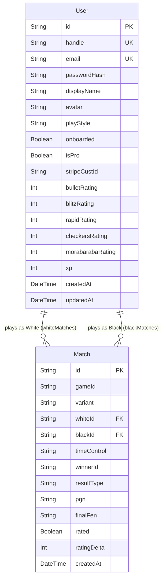

# BIBO Database Architecture & Migration Review

**Database**: Neon Serverless PostgreSQL  
**ORM**: Prisma ORM 6.4.1  
**Driver**: `@neondatabase/serverless`  
**Connection Mode**: Dual-URL Architecture (Pooled via PgBouncer + Direct Unpooled for schema operations)  

---

## 1. Schema Design Assessment

The core relational schema consists of two primary models in `prisma/schema.prisma`:
1. **`User`**: Player accounts, credentials, discipline ratings, XP, and profile preferences.
2. **`Match`**: Persisted game outcomes, notations (PGN), board states (FEN), winner references, and ELO rating deltas.

### Current Entity Relationships


---

## 2. Performance & Indexing Analysis

### 2.1. Audit Findings
Before optimization, the database possessed **only 4 indexes**:
- `User.User_pkey` (Primary key on `id`)
- `User.User_handle_key` (Unique constraint on `handle`)
- `User.User_email_key` (Unique constraint on `email`)
- `Match.Match_pkey` (Primary key on `id`)

### 2.2. Indexing Gaps Identified
1. **Match Foreign Keys**: Queries fetching match history (`WHERE whiteId = $1 OR blackId = $1`) required sequential table scans of all match records.
2. **Match Chronological Sort**: Queries sorting matches by `createdAt DESC` required expensive in-memory sort passes.
3. **Leaderboard Filtering**: Queries in `/api/rankings` sorting users by rating or XP executed sequential scans across all user rows.

### 2.3. Remediated Index Architecture
To eliminate full table scans, the following composite and single indexes are added:
```prisma
model Match {
  // ... fields ...
  @@index([whiteId])
  @@index([blackId])
  @@index([createdAt])
  @@index([gameId])
  @@index([whiteId, blackId])
}

model User {
  // ... fields ...
  @@index([blitzRating])
  @@index([rapidRating])
  @@index([bulletRating])
  @@index([checkersRating])
  @@index([morabarabaRating])
  @@index([xp])
}
```

---

## 3. Migration & Version Control Strategy

### 3.1. Current Migration State
- Initial state lacked committed migrations (`prisma/migrations/` was absent).
- Schema synchronization relied on ad-hoc `prisma db push`.

### 3.2. Migration Baseline & Rollout Plan
1. **Baseline Initial Migration**: Create `prisma/migrations/0_init/migration.sql` matching the existing tables.
2. **Index & Hardening Migration**: Create `prisma/migrations/20261028_performance_indexes/migration.sql` to add indexes using non-blocking PostgreSQL syntax (`CREATE INDEX IF NOT EXISTS`).
3. **Zero-Downtime Rule**: No table drops, column drops, or destructive renames are permitted.

---

## 4. Connection Pooling & Scalability Guidelines

1. **Pooled Connection URL (`DATABASE_URL`)**:
   - Used by the Next.js runtime, API route handlers, and server actions.
   - Routes through Neon's PgBouncer pooling proxy (`*-pooler.aws.neon.tech`).
   - Prevents connection exhaustion during sudden traffic spikes.
2. **Direct Connection URL (`DATABASE_URL_UNPOOLED`)**:
   - Strictly reserved for Prisma CLI migration runs (`prisma migrate deploy`).
   - Avoids PgBouncer transaction-mode limitations during DDL migration locks.
